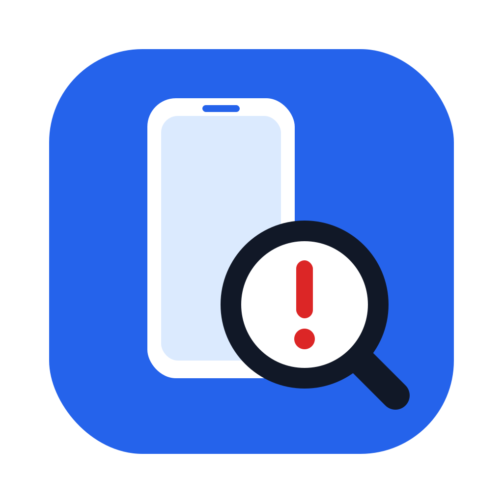
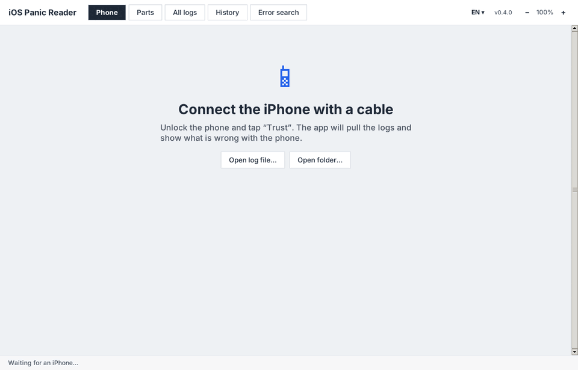
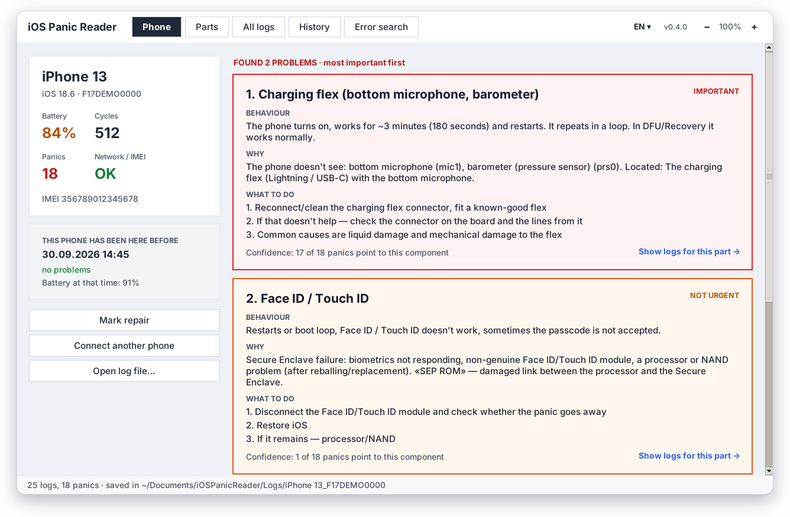
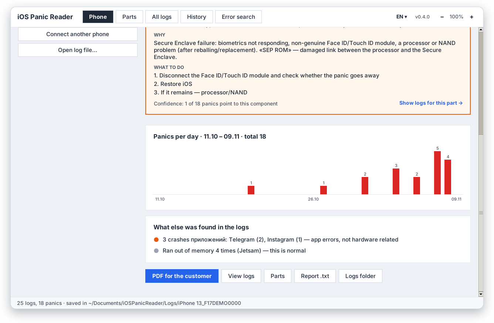
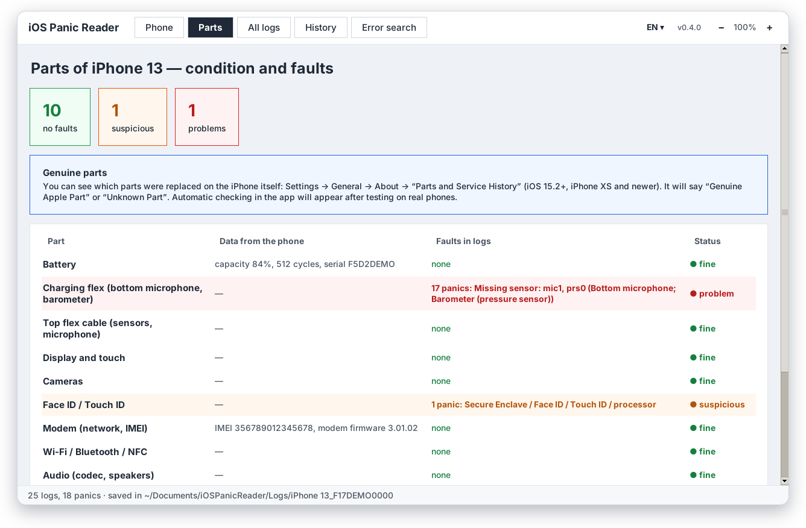
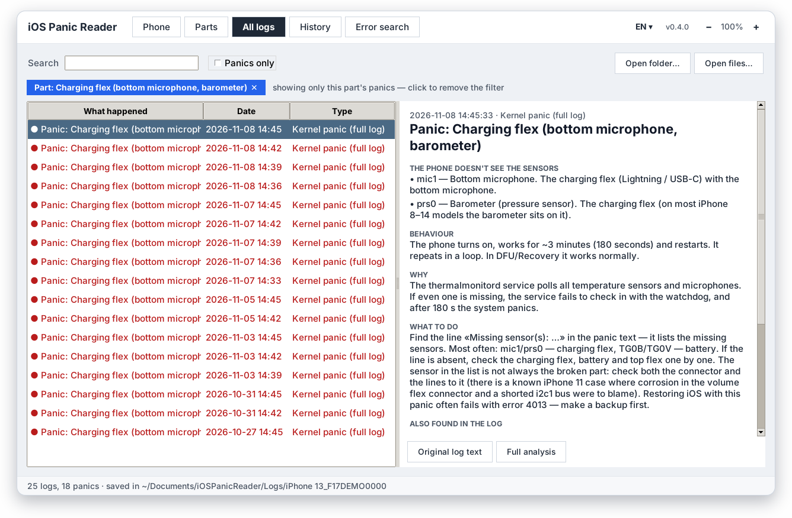
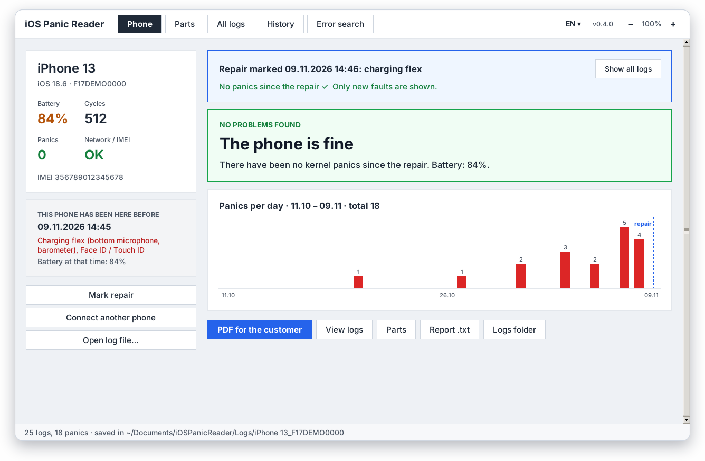
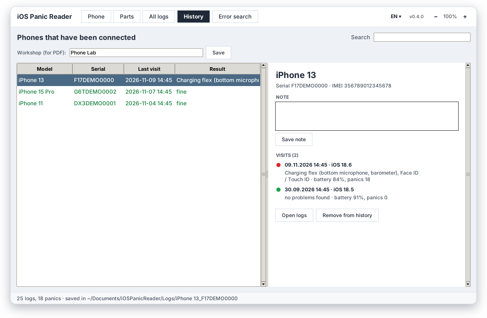
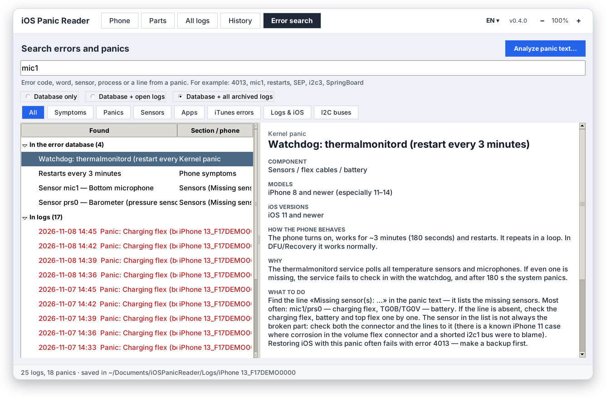
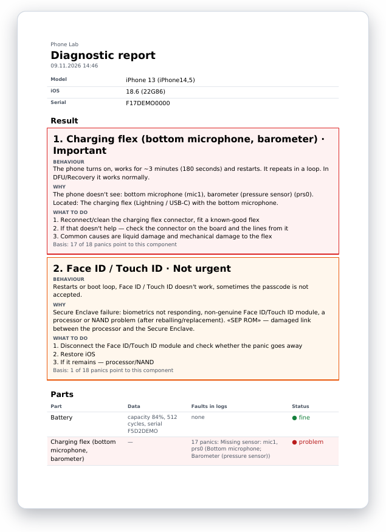

<div align="center">



# iOS Panic Reader

**Plug in an iPhone — the app pulls the logs and tells you which part is to blame.**

[](https://github.com/mr1garik/ios-panic-reader/releases/latest)
[](https://github.com/mr1garik/ios-panic-reader/releases)


[Русский](README.md) · **English** · [Українська](README.uk.md)

<a href="https://github.com/mr1garik/ios-panic-reader/releases/latest/download/iOSPanicReader.exe"></a>
<a href="https://github.com/mr1garik/ios-panic-reader/releases/latest/download/iOSPanicReader-macOS.zip"></a>

<br><br>



</div>

---

## Features

|  |  |
|---|---|
| 🔌 **Pulls the logs for you** | Connect the cable, tap “Trust” on the phone — the app collects every fault log and shows the model, iOS, IMEI, battery wear and cycle count. |
| 🩺 **Tells you what's broken** | Not “thermalmonitord panic” but “**Charging flex** — the phone can't see the bottom microphone and the barometer”. With how the phone behaves, why, and what to do. |
| 📊 **Confidence and a chart** | “17 of 18 panics point to this part”, plus panics per day — you can see when the trouble started. |
| 🔧 **Before and after repair** | “Mark repair” — from then on only new faults count: “No panics since the repair ✓”. |
| 🗂 **Phone history** | Every connected phone with visits, repairs and notes. When a customer comes back, you see what happened last time. |
| 📄 **PDF for the customer** | A report with the conclusion, the state of each part and your workshop name. |
| 🔎 **Error search** | A code (4013), a sensor (mic1), a bus (i2c3), a word or a line from a panic — across the database and all logs. Paste panic text from the phone and get the analysis right away. |
| 🌍 **Three languages, auto-update** | Русский, English, Українська. The app downloads new versions by itself — your data is never touched. |

## Screenshots

<table>
<tr>
<td width="50%"><br><sub><b>Result</b> — problems found, most important first, with explanation and steps</sub></td>
<td width="50%"><br><sub><b>Panics per day</b> and what else was found in the logs</sub></td>
</tr>
<tr>
<td><br><sub><b>Parts</b> — the state of each part and its faults in the logs</sub></td>
<td><br><sub><b>Logs for this part</b> — every panic explained</sub></td>
</tr>
<tr>
<td><br><sub><b>After the repair</b> — only new faults count</sub></td>
<td><br><sub><b>History</b> — phones, visits, repairs, notes</sub></td>
</tr>
<tr>
<td><br><sub><b>Search</b> across the error database and all logs</sub></td>
<td><br><sub><b>PDF report</b> for the customer</sub></td>
</tr>
</table>

<sub>Screenshots use demo data.</sub>

## Installation

### Windows 10 / 11
1. Download [`iOSPanicReader.exe`](https://github.com/mr1garik/ios-panic-reader/releases/latest/download/iOSPanicReader.exe).
2. Install **Apple Devices** from the Microsoft Store (or iTunes) — it provides the iPhone driver.
3. If Windows shows “Windows protected your PC” — “More info” → “Run anyway” (the app isn't signed).

### Mac (M1 and newer)
1. Download [`iOSPanicReader-macOS.zip`](https://github.com/mr1garik/ios-panic-reader/releases/latest/download/iOSPanicReader-macOS.zip), unzip it, move `iOSPanicReader.app` to Applications.
2. First launch: **right-click → Open → Open** (the app isn't signed by Apple).
3. If macOS says the app is “damaged”:
   ```bash
   xattr -dr com.apple.quarantine /Applications/iOSPanicReader.app
   ```

No driver is needed on a Mac — it's built in. On Intel Macs run it from source (`start.command`).

## How to use

1. Launch the app and connect the iPhone with a cable.
2. Unlock the phone and tap **“Trust”**.
3. A few seconds later you get the result: what's wrong and what to do.

You can also open logs without a phone: **“Open log file…”** (`panic-full-*.ips` files from the phone:
Settings → Privacy & Security → Analytics & Improvements → Analytics Data).

## Your data

Everything stays on your computer in `Documents/iOSPanicReader`: logs, phone history, notes, the
workshop name. The app sends nothing anywhere — it only goes online to check GitHub for updates.
Updates never touch your data, and a copy of the history is kept in `backups/`.

## Error database

Almost a hundred entries: kernel panics (thermalmonitord, SEP, AOP, NAND, SMC, I2C…), sensors from
“Missing sensor(s)” (mic1, prs0, TG0B…), I2C buses per model, iTunes/Finder error codes (9, 4013,
53…), app crash codes (0x8badf00d…) and symptoms (“restarts every 3 minutes”). Every entry lists its
sources and reliability: Apple documentation, repeatedly confirmed, or “reported by repair shops”.

> The hints are a guide for diagnostics, not a final diagnosis: sensor and bus locations depend on
> the model.

## For developers

Running from source, building, tests, the database and translations — see
[docs/DEVELOPMENT.md](docs/DEVELOPMENT.md) (in Russian).
