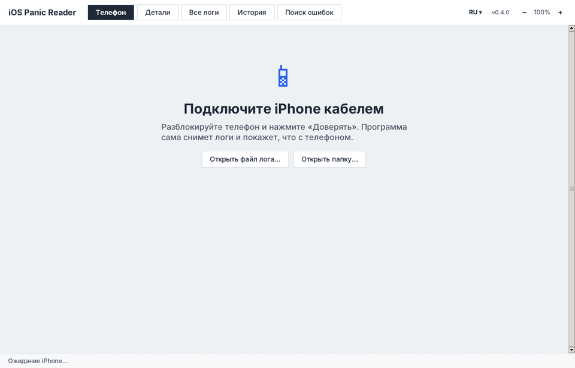
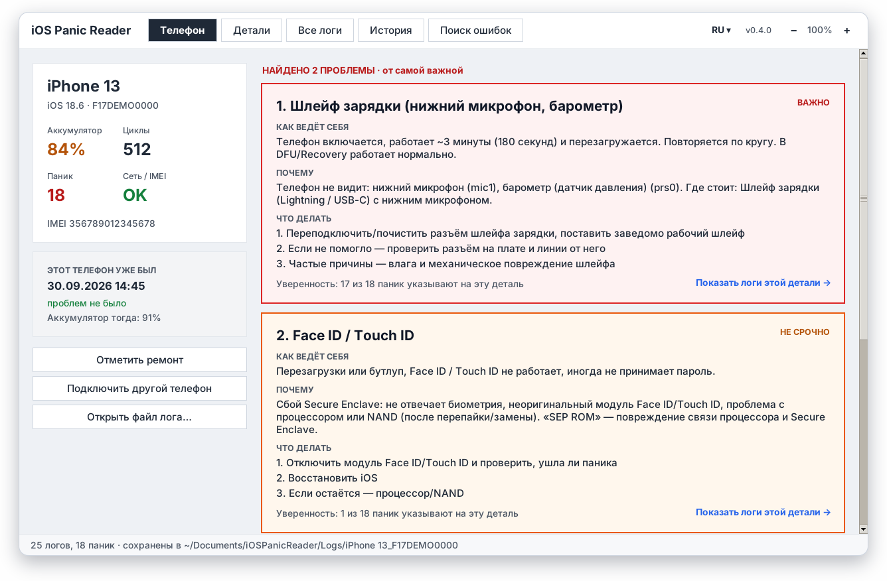
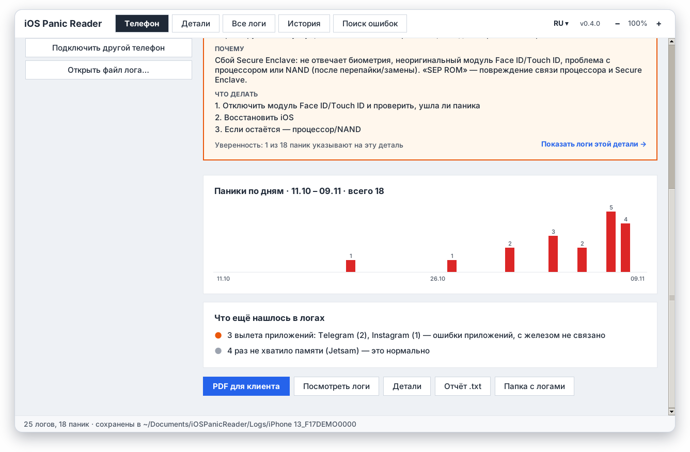
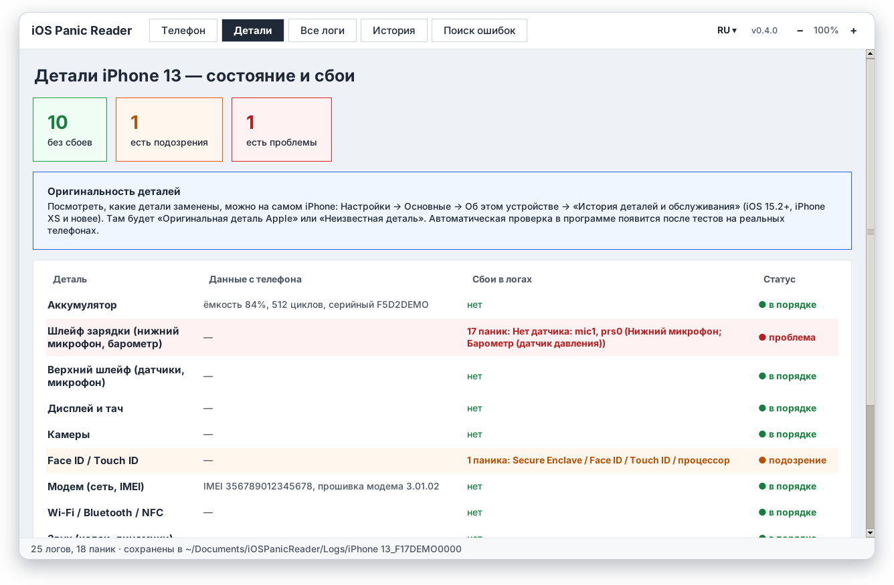
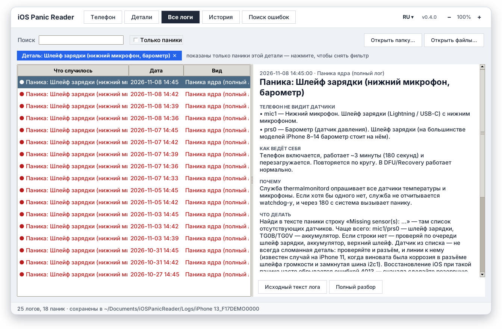
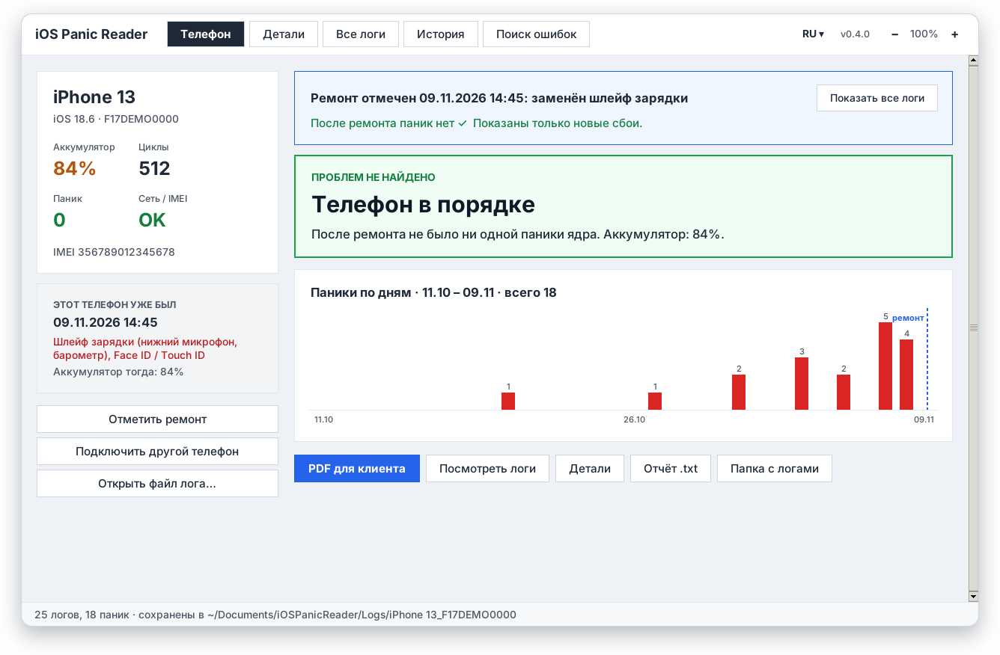
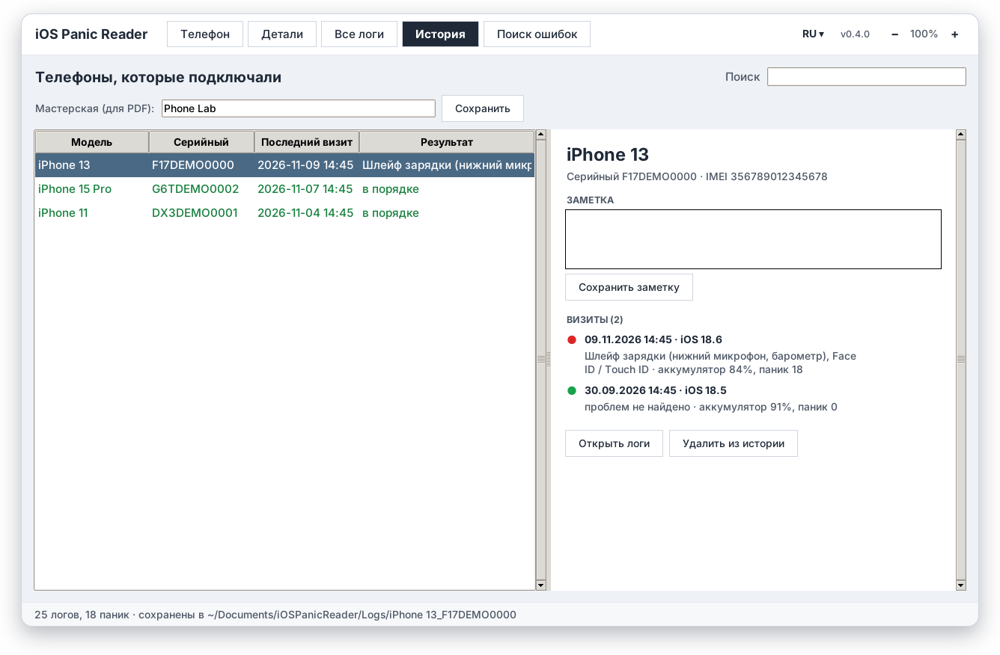
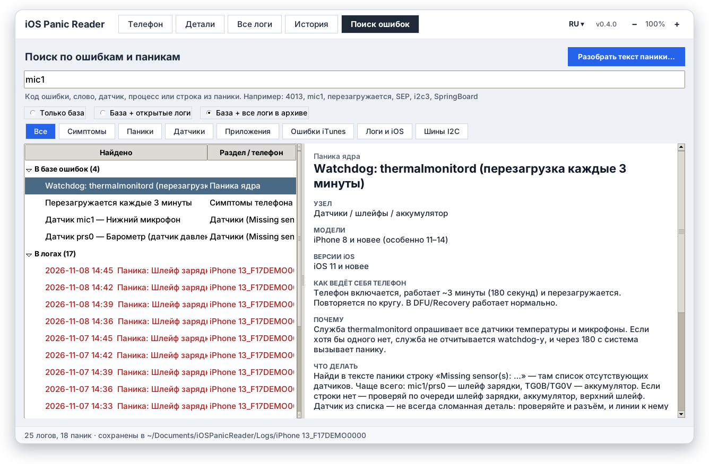
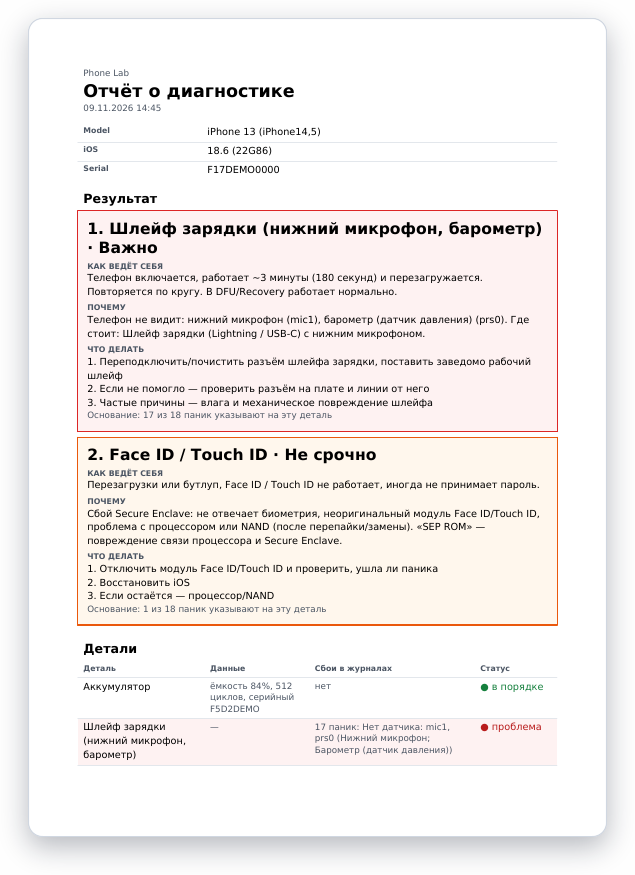

<div align="center">


# iOS Panic Reader

**Подключили iPhone — программа сама сняла логи и сказала, какая деталь виновата.**

[](https://github.com/mr1garik/ios-panic-reader/releases/latest)
[](https://github.com/mr1garik/ios-panic-reader/releases)


**Русский** · [English](README.en.md) · [Українська](README.uk.md)

<a href="https://github.com/mr1garik/ios-panic-reader/releases/latest/download/iOSPanicReader.exe"></a>
<a href="https://github.com/mr1garik/ios-panic-reader/releases/latest/download/iOSPanicReader-macOS.zip"></a>

<br><br>



</div>

---

## Что умеет

|  |  |
|---|---|
| 🔌 **Сама снимает логи** | Подключили кабелем, нажали «Доверять» на телефоне — программа забирает все логи сбоев, показывает модель, iOS, IMEI, износ аккумулятора и циклы. |
| 🩺 **Говорит, что сломалось** | Не «паника thermalmonitord», а «**Шлейф зарядки** — телефон не видит нижний микрофон и барометр». С объяснением: как ведёт себя телефон, почему и что делать. |
| 📊 **Уверенность и график** | «17 из 18 паник указывают на эту деталь», график паник по дням — видно, когда начались проблемы. |
| 🔧 **До и после ремонта** | «Отметить ремонт» — дальше считаются только новые сбои: «После ремонта паник нет ✓». |
| 🗂 **История телефонов** | Каждый подключённый телефон с визитами, ремонтами и заметками. Вернулся клиент — видно, что было в прошлый раз. |
| 📄 **PDF для клиента** | Отчёт с выводом, состоянием деталей и названием вашей мастерской. |
| 🔎 **Поиск по ошибкам** | Код (4013), датчик (mic1), шина (i2c3), слово или строка из паники — по базе и по всем логам. Можно вставить текст паники с телефона и сразу получить разбор. |
| 🌍 **Три языка, автообновление** | Русский, English, Українська. Программа сама скачивает новые версии — данные при этом не трогаются. |

## Скриншоты

<table>
<tr>
<td width="50%"><br><sub><b>Результат</b> — найденные проблемы от самой важной, с объяснением и шагами</sub></td>
<td width="50%"><br><sub><b>График паник по дням</b> и что ещё нашлось в логах</sub></td>
</tr>
<tr>
<td><br><sub><b>Детали</b> — что с каждой деталью и какие сбои в логах</sub></td>
<td><br><sub><b>Логи этой детали</b> — расшифровка каждой паники</sub></td>
</tr>
<tr>
<td><br><sub><b>После ремонта</b> — учитываются только новые сбои</sub></td>
<td><br><sub><b>История</b> — телефоны, визиты, ремонты, заметки</sub></td>
</tr>
<tr>
<td><br><sub><b>Поиск</b> по базе ошибок и по всем логам</sub></td>
<td><br><sub><b>PDF-отчёт</b> для клиента</sub></td>
</tr>
</table>

<sub>Скриншоты сняты на демонстрационных данных.</sub>

## Установка

### Windows 10 / 11
1. Скачайте [`iOSPanicReader.exe`](https://github.com/mr1garik/ios-panic-reader/releases/latest/download/iOSPanicReader.exe).
2. Установите **Apple Devices** из Microsoft Store (или iTunes) — это драйвер iPhone.
3. Если Windows покажет «Windows защитила ваш компьютер» — «Подробнее» → «Выполнить в любом случае» (программа не подписана).

### Mac (M1 и новее)
1. Скачайте [`iOSPanicReader-macOS.zip`](https://github.com/mr1garik/ios-panic-reader/releases/latest/download/iOSPanicReader-macOS.zip), распакуйте, перенесите `iOSPanicReader.app` в «Программы».
2. Первый запуск: **правый клик → «Открыть» → «Открыть»** (программа не подписана Apple).
3. Если macOS пишет, что приложение «повреждено»:
   ```bash
   xattr -dr com.apple.quarantine /Applications/iOSPanicReader.app
   ```

Драйвер на Mac не нужен — он встроен в систему. На Mac с Intel запускайте из исходников (`start.command`).

## Как пользоваться

1. Запустите программу и подключите iPhone кабелем.
2. Разблокируйте телефон и нажмите **«Доверять»**.
3. Через несколько секунд — результат: что с телефоном и что делать.

Логи можно открыть и без телефона: **«Открыть файл лога…»** (файлы `panic-full-*.ips` с телефона:
Настройки → Конфиденциальность и безопасность → Аналитика и улучшения → Данные аналитики).

## Ваши данные

Всё хранится у вас на компьютере в `Документы/iOSPanicReader`: логи, история телефонов, заметки,
название мастерской. Программа ничего никуда не отправляет — в интернет она ходит только за
обновлениями на GitHub. При обновлении данные не трогаются, а копия истории сохраняется в `backups/`.

## База ошибок

Почти сто записей: паники ядра (thermalmonitord, SEP, AOP, NAND, SMC, I2C…), датчики из
«Missing sensor(s)» (mic1, prs0, TG0B…), шины I2C по моделям, коды ошибок iTunes/Finder (9, 4013,
53…), коды вылетов приложений (0x8badf00d…) и симптомы («перезагружается каждые 3 минуты»).
У каждой записи указаны источники и надёжность: документация Apple, многократно подтверждено, или
«по сообщениям сервисов».

> Подсказки — ориентир для диагностики, а не окончательный диагноз: расположение датчиков и шин
> зависит от модели.

## Для разработчиков

Запуск из исходников, сборка, тесты, база ошибок и переводы — в [docs/DEVELOPMENT.md](docs/DEVELOPMENT.md).
