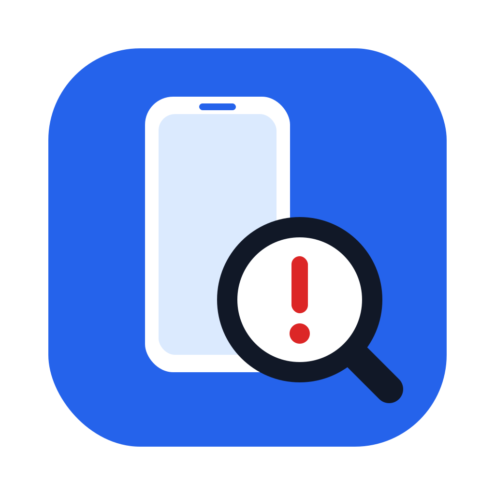
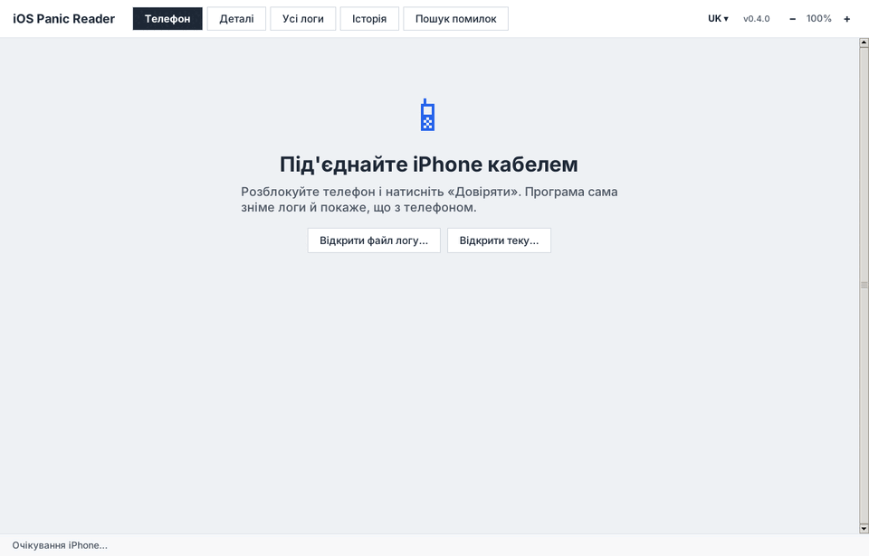
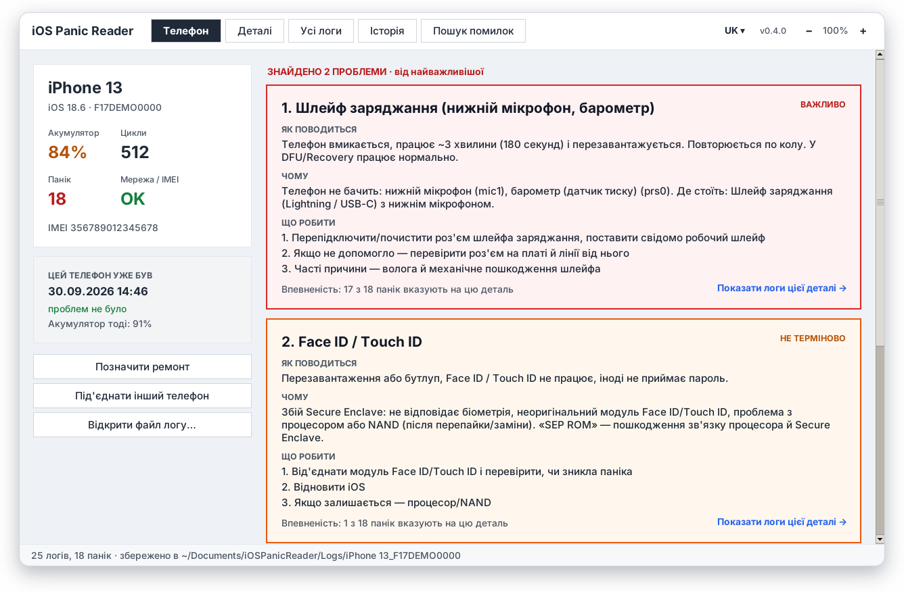
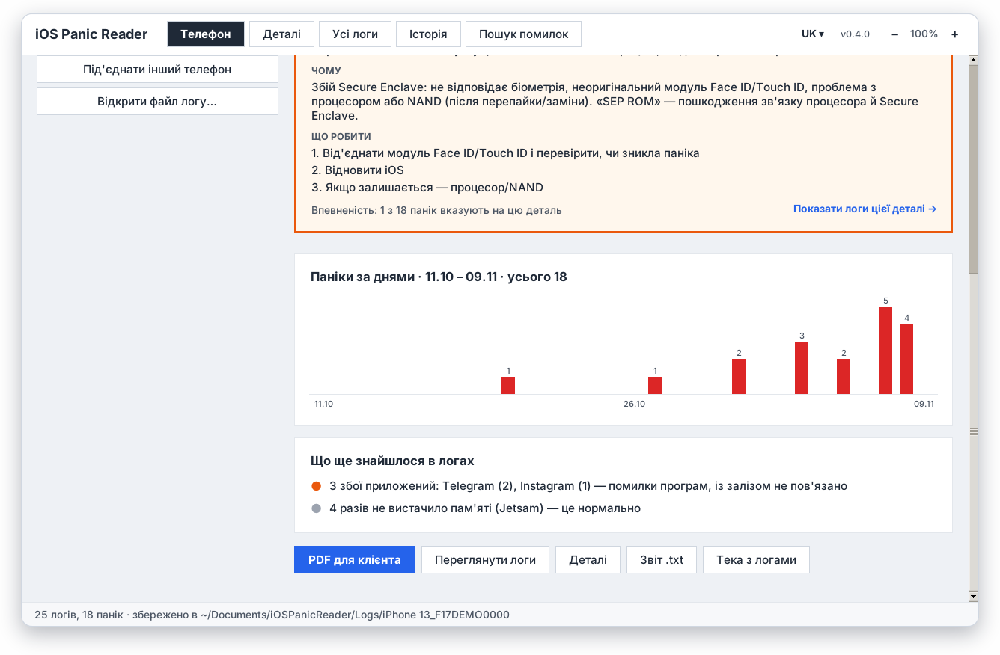
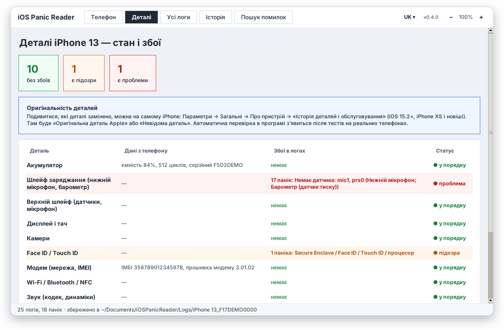
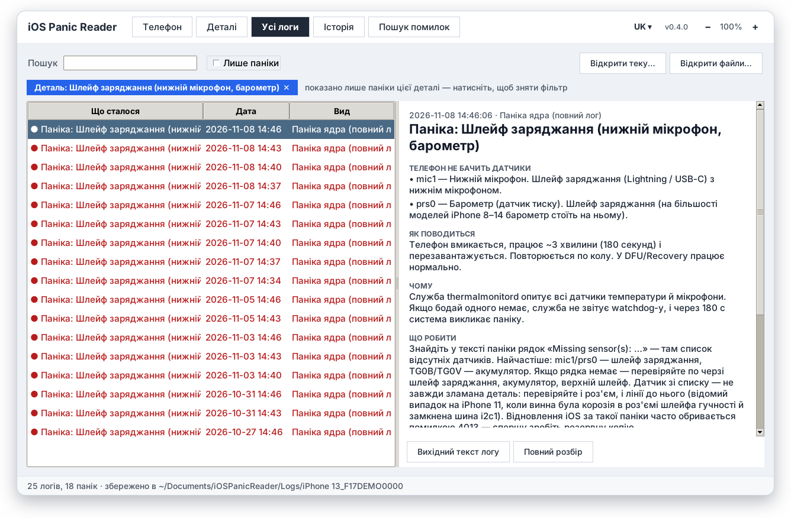
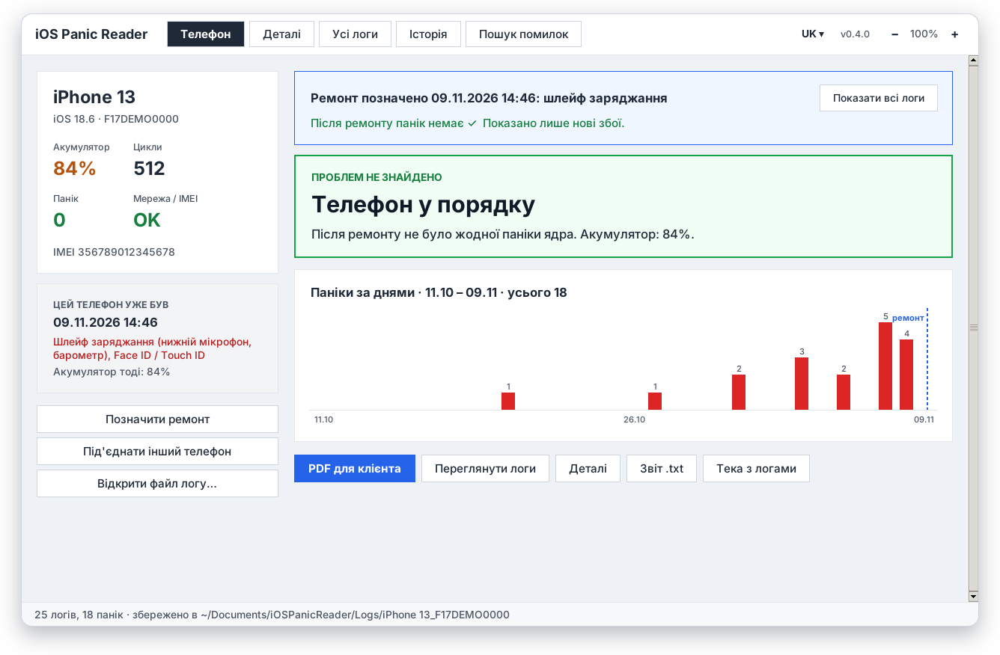
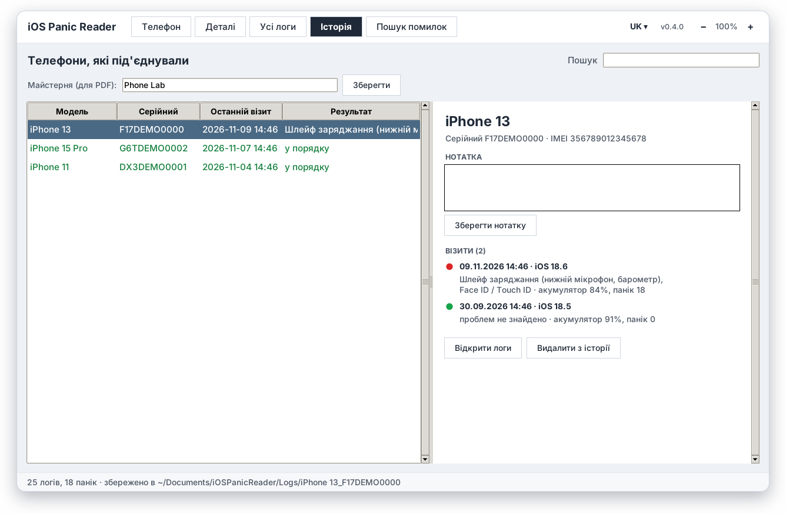
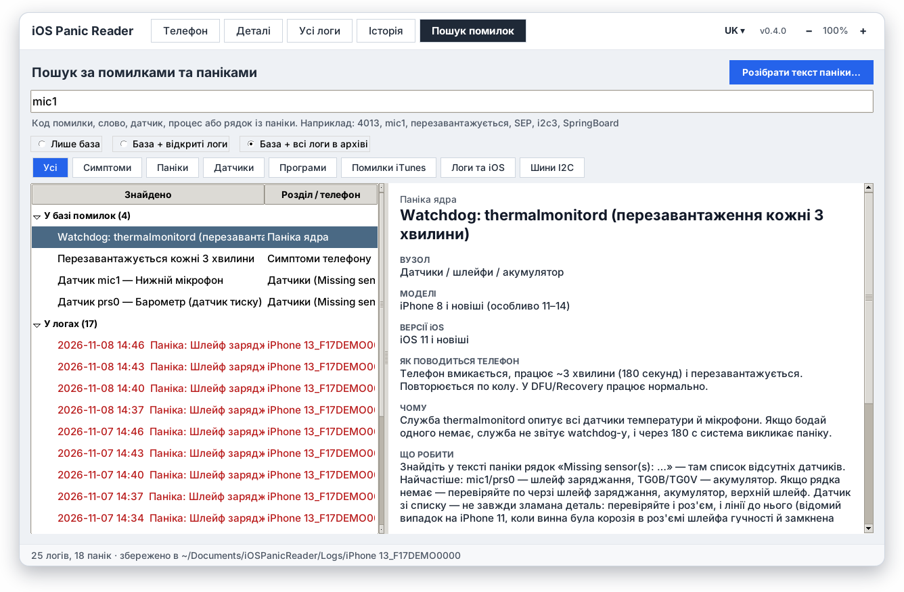
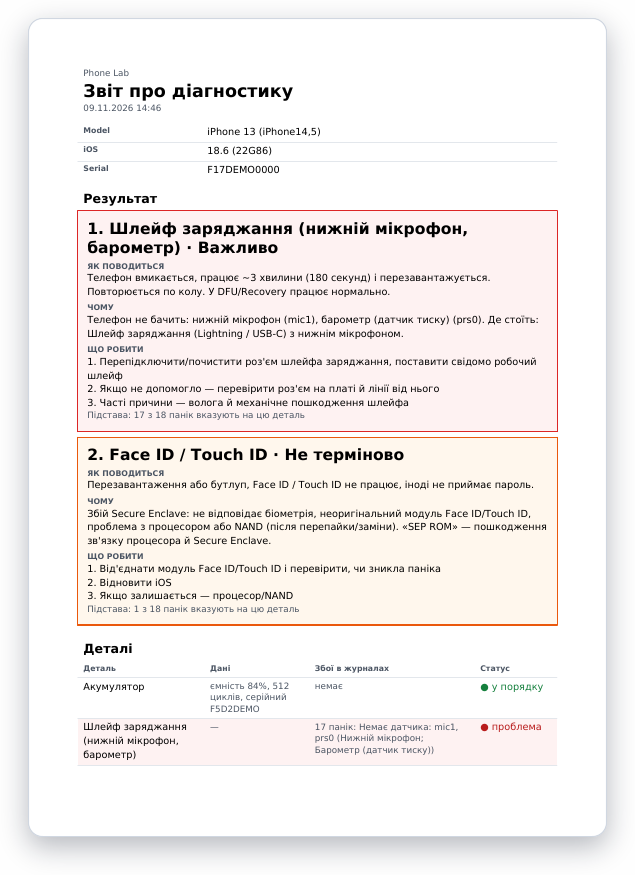

<div align="center">



# iOS Panic Reader

**Під'єднали iPhone — програма сама зняла логи й сказала, яка деталь винна.**

[](https://github.com/mr1garik/ios-panic-reader/releases/latest)
[](https://github.com/mr1garik/ios-panic-reader/releases)


[Русский](README.md) · [English](README.en.md) · **Українська**

<a href="https://github.com/mr1garik/ios-panic-reader/releases/latest/download/iOSPanicReader.exe"></a>
<a href="https://github.com/mr1garik/ios-panic-reader/releases/latest/download/iOSPanicReader-macOS.zip"></a>

<br><br>



</div>

---

## Що вміє

|  |  |
|---|---|
| 🔌 **Сама знімає логи** | Під'єднали кабелем, натиснули «Довіряти» на телефоні — програма забирає всі логи збоїв, показує модель, iOS, IMEI, знос акумулятора й цикли. |
| 🩺 **Каже, що зламалося** | Не «паніка thermalmonitord», а «**Шлейф заряджання** — телефон не бачить нижній мікрофон і барометр». З поясненням: як поводиться телефон, чому й що робити. |
| 📊 **Впевненість і графік** | «17 з 18 панік вказують на цю деталь», графік панік за днями — видно, коли почалися проблеми. |
| 🔧 **До і після ремонту** | «Позначити ремонт» — далі враховуються лише нові збої: «Після ремонту панік немає ✓». |
| 🗂 **Історія телефонів** | Кожен під'єднаний телефон із візитами, ремонтами й нотатками. Повернувся клієнт — видно, що було минулого разу. |
| 📄 **PDF для клієнта** | Звіт із висновком, станом деталей і назвою вашої майстерні. |
| 🔎 **Пошук помилок** | Код (4013), датчик (mic1), шина (i2c3), слово або рядок із паніки — у базі й у всіх логах. Можна вставити текст паніки з телефону й одразу отримати розбір. |
| 🌍 **Три мови, автооновлення** | Русский, English, Українська. Як у 3uTools: під час запуску — вікно «Доступна нова версія» зі списком змін, «Оновити зараз» — завантаження з прогресом і перезапуск. Дані не чіпаються. |

## Знімки екрана

<table>
<tr>
<td width="50%"><br><sub><b>Результат</b> — знайдені проблеми від найважливішої, з поясненням і кроками</sub></td>
<td width="50%"><br><sub><b>Графік панік за днями</b> і що ще знайшлося в логах</sub></td>
</tr>
<tr>
<td><br><sub><b>Деталі</b> — стан кожної деталі та її збої в логах</sub></td>
<td><br><sub><b>Логи цієї деталі</b> — розшифрування кожної паніки</sub></td>
</tr>
<tr>
<td><br><sub><b>Після ремонту</b> — враховуються лише нові збої</sub></td>
<td><br><sub><b>Історія</b> — телефони, візити, ремонти, нотатки</sub></td>
</tr>
<tr>
<td><br><sub><b>Пошук</b> у базі помилок і в усіх логах</sub></td>
<td><br><sub><b>PDF-звіт</b> для клієнта</sub></td>
</tr>
</table>

<sub>Знімки зроблено на демонстраційних даних.</sub>

## Встановлення

### Windows 10 / 11
1. Завантажте [`iOSPanicReader.exe`](https://github.com/mr1garik/ios-panic-reader/releases/latest/download/iOSPanicReader.exe).
2. Встановіть **Apple Devices** з Microsoft Store (або iTunes) — це драйвер iPhone.
3. Якщо Windows покаже «Windows захистила ваш комп'ютер» — «Докладніше» → «Однаково запустити» (програму не підписано).

### Mac (M1 і новіші)
1. Завантажте [`iOSPanicReader-macOS.zip`](https://github.com/mr1garik/ios-panic-reader/releases/latest/download/iOSPanicReader-macOS.zip), розпакуйте, перенесіть `iOSPanicReader.app` у «Програми».
2. Перший запуск: **правий клік → «Відкрити» → «Відкрити»** (програму не підписано Apple).
3. Якщо macOS пише, що програма «пошкоджена»:
   ```bash
   xattr -dr com.apple.quarantine /Applications/iOSPanicReader.app
   ```

Драйвер на Mac не потрібен — він вбудований у систему. На Mac з Intel запускайте з вихідних кодів (`start.command`).

## Як користуватися

1. Запустіть програму й під'єднайте iPhone кабелем.
2. Розблокуйте телефон і натисніть **«Довіряти»**.
3. За кілька секунд — результат: що з телефоном і що робити.

Логи можна відкрити й без телефону: **«Відкрити файл логу…»** (файли `panic-full-*.ips` з телефону:
Параметри → Приватність і безпека → Аналітика й покращення → Дані аналітики).

## Ваші дані

Усе зберігається на вашому комп'ютері в `Документи/iOSPanicReader`: логи, історія телефонів,
нотатки, назва майстерні. Програма нічого нікуди не надсилає — в інтернет вона ходить лише по
оновлення на GitHub. Під час оновлення дані не чіпаються, а копія історії зберігається в `backups/`.

## База помилок

Майже сто записів: паніки ядра (thermalmonitord, SEP, AOP, NAND, SMC, I2C…), датчики з
«Missing sensor(s)» (mic1, prs0, TG0B…), шини I2C за моделями, коди помилок iTunes/Finder (9, 4013,
53…), коди збоїв програм (0x8badf00d…) і симптоми («перезавантажується кожні 3 хвилини»). У кожного
запису вказано джерела й надійність: документація Apple, багаторазово підтверджено, або «за
повідомленнями сервісів».

> Підказки — орієнтир для діагностики, а не остаточний діагноз: розташування датчиків і шин
> залежить від моделі.

## Інші мої проєкти

**[iActivator](https://github.com/mr1garik/iActivator)** — активація й налаштування iPhone в один клік: активація, мова, регіон, Wi-Fi, пропуск екранів налаштування, діагностика й PDF-звіт. Windows і macOS, безкоштовно.

## Для розробників

Запуск із вихідних кодів, збирання, тести, база помилок і переклади — у
[docs/DEVELOPMENT.md](docs/DEVELOPMENT.md) (російською).
